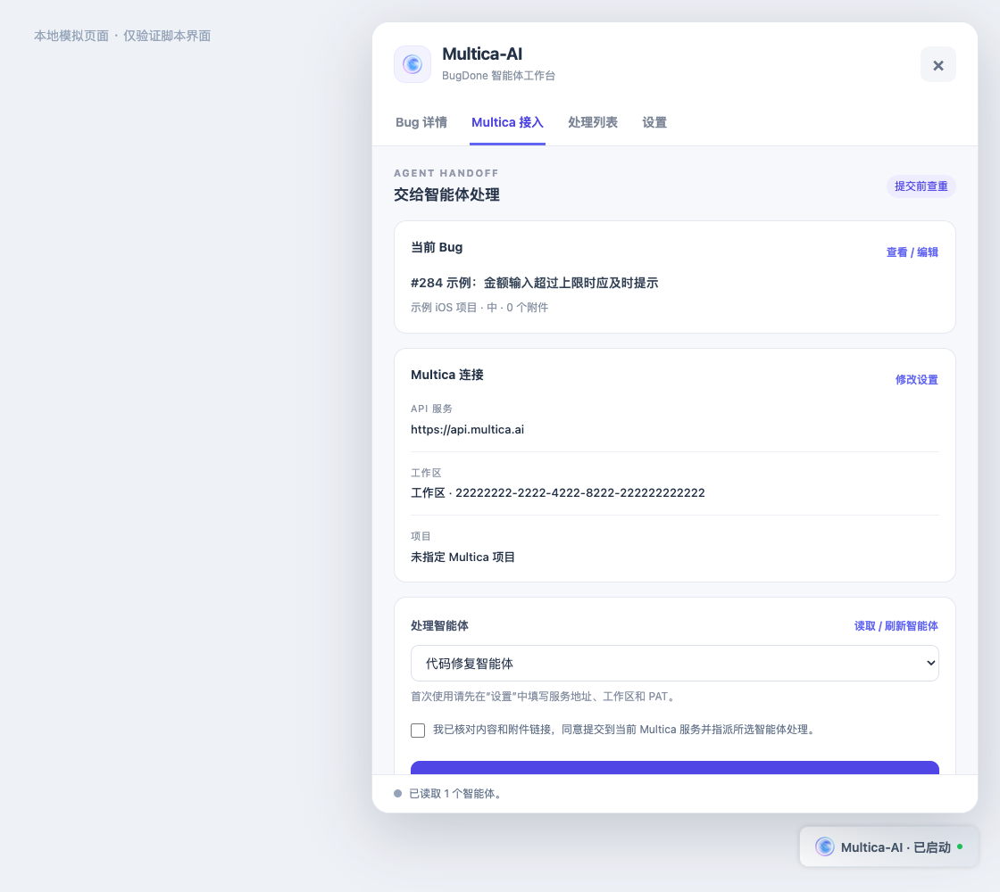

# BugDone → Multica Bridge

一个油猴脚本，在 BugDone 页面中读取 Bug 详情，将 Bug 创建为 Multica 任务并指派给智能体。支持 Mac App WebView 的 Fastlane 原生网络桥。



*界面预览使用本地模拟数据，展示的是旧版布局；当前界面以脚本为准。*

## 安装

1. 从 [脚本安装地址](https://raw.githubusercontent.com/bosong/bugdone-multica-bridge/main/bugdone-multica.user.js) 安装到 Tampermonkey，打开并登录 BugDone。已有的本地安装需要手动更新一次到 v0.9.2，之后可通过 `@updateURL` 检查新版本。
2. 打开某个 Bug 详情，点击右下角 **Multica-AI · 已启动**。
3. 在设置的 API 服务下拉框中选择官方服务，或选择“添加自建服务器”后填写地址；再填写 API Token。脚本会自动读取并缓存工作区、项目、智能体和标签。以后启动直接恢复缓存，只有缓存缺失、Token 变化或手动刷新时才请求这些列表。
4. 在 Bug 详情核对捕获内容，点击 **下一步：AI任务创建**，编辑任务标题、描述、状态、优先级、智能体、项目、标签或有效日期，然后创建任务。第一栏生成的标题以 `[BugDone] #编号` 开头，并在末尾带有用于查重的 Bug ID 标记。第二栏显示的标题和描述会原样提交；若删掉标题中的查重标记，脚本会阻止提交并提示重新生成。

面板右上角的 **打开 Multica** 会尝试唤起已安装的 Multica 桌面程序；未检测到成功切换时打开 [Multica 官网](https://multica.ai)。FastlaneTool 内置 WebView 需要包含 `multica://` 外部协议转发的新版宿主程序。

入口按钮按最近一次 API 验证结果显示 **未配置、待连接、连接中、已连接、连接失败**。已保存选项在启动时仍从本地恢复，同时用 `GET /api/me` 验证令牌；不会因此重新拉取项目、智能体和标签列表。

脚本会先查找同一 Bug 的已有任务，避免重复创建。新任务提交前，脚本会从 `img.bugdone.cn` 获取截图，上传到 Multica，再通过 `attachment_ids` 将截图关联到任务。图片读取或上传失败时会停止创建并显示原因。非图片附件目前只作为原始链接写入任务描述。

## Mac App WebView

没有 `GM_xmlhttpRequest` 时，脚本优先使用 `FastlaneNativeNetwork`。Mac App 需安装支持 `sourceUrl` 图片转传的新版原生网络桥，且脚本元数据必须包含 `@fastlane-network`、Multica API 主机和 `img.bugdone.cn` 的 `@connect` 声明。旧版 App 回退到网页 `fetch`，可能因 CORS 无法提交。

自建 Multica API 需要在脚本头部添加对应的 `@connect` 主机名，再重新安装或加载脚本。不要在仓库、截图或 Issue 中提交 PAT、Cookie 或 BugDone 私有数据。

## 本地检查

需要 Node.js，无第三方依赖：

```sh
npm run check
npm test
```

任务创建成功只表示已提交并指派；智能体的实际执行状态请到 Multica 查看。已创建任务不会因再次点击提交而重新触发。
